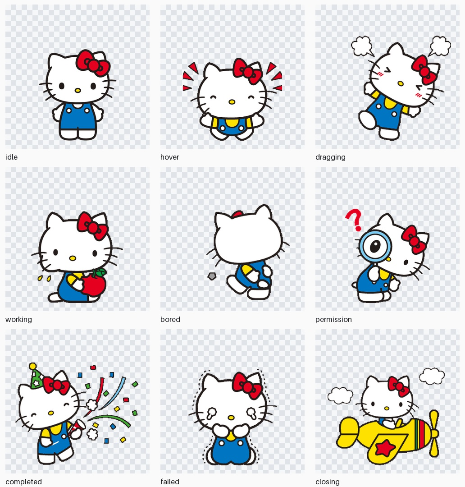

# Codex Kitty Desktop Pet

## 个人定制版 · 2026-10-18

这是基于 [eatingwang012/codex-kitty-desktop-pet](https://github.com/eatingwang012/codex-kitty-desktop-pet)
保存的个人增强版本，保留原项目历史和 GPL-3.0 许可。

- 精细像素 Hello Kitty，默认小尺寸 144。
- 安静动画：约 6 秒一次，最多移动 1 像素；退出时原地淡出。
- 显示聊天标题与任务状态气泡，多任务优先提示等待确认。
- 点击 Kitty 或气泡打开 Codex，拖动移动，右键可隐藏状态气泡。
- 状态气泡点击只唤起聊天窗口，授权仍由用户在 Codex 中确认。

Windows 版已在 **Windows 11 x64** 上验证；macOS 原生适配及构建方法见 [macOS 说明](docs/MACOS.md)。
Windows EXE 不能安装到 Mac，请在 Mac 构建 `.app`。
完整版本说明、恢复方法及 Mac 适配清单见 [个人版本存档](docs/PERSONAL_VERSION.md)。


一个运行在 Windows 桌面上的透明 Codex 状态宠物。它只读监听本机 Codex
会话，根据任务、权限请求、完成、失败和空闲状态切换动画；鼠标悬停时还会
显示 5 小时与 7 天用量窗口及刷新倒计时。



## 功能

像素增强版：使用透明像素 Hello Kitty 九状态图集，默认显示尺寸 144，
以最近邻缩放保持像素边缘，带轻微浮动和离开动画。

安静动画：约 6 秒一次、上下最多 1 像素；状态稳定 1.2 秒再切换姿势，
拖动时不晃动，退出时原地淡出。点击、悬停和拖动仍及时响应。

任务状态气泡：显示本地聊天标题与处理中、等待确认、完成、出错、空闲状态。
只读查询本机 `state_*.sqlite` 的标题索引，不记录标题到日志。多任务优先显示
等待确认的任务；点击气泡唤起 Codex。右键菜单可隐藏气泡。
状态来自本地会话记录，可能有短暂延迟；不会代替用户批准授权。

本机增强版：单击 Kitty 唤起已打开的 Codex/ChatGPT 桌面聊天窗口，拖动仍用于移动宠物。
右键菜单提供“打开 Codex / 查看授权”。授权仍在聊天窗口中手动确认；本功能不会自动批准，
也不会自动切换到其他聊天。未找到窗口时会显示托盘提示。

- 透明、置顶、可拖动的 Windows 桌宠
- 九种状态：正常、悬停、拖动、工作、无聊、权限、完成、失败、离开
- 只读解析 `%CODEX_HOME%\sessions` 和 `logs_2.sqlite`
- 悬停显示 Codex 5 小时/7 天剩余用量与刷新倒计时
- 系统托盘隐藏、召回和彻底退出
- 当前用户登录自启动
- 单文件 Windows EXE，无需单独安装 Python

## 下载和安装

1. 打开仓库的 **Releases** 页面并下载 `CodexKittyPet-v1.0.0-win64.zip`。
2. 解压 ZIP，双击 `CodexKittyPet.exe` 可直接运行。
3. 需要登录自启动时，右键 PowerShell 运行 `install.ps1`。
4. 卸载时运行 `uninstall.ps1`；加 `-RemoveSettings` 可删除设置和日志。

发布包未做商业代码签名，Windows SmartScreen 可能显示未知发布者。请仅从本仓库
Release 下载，并在运行前核对 Release 页面中的文件来源。

## 运行条件

- Windows 10 或 Windows 11 x64
- 已使用过 Codex Desktop 或 Codex CLI
- 默认读取 `%USERPROFILE%\.codex`；设置了 `CODEX_HOME` 时自动使用该目录

监听不可用时，宠物仍支持正常、悬停、拖动、无聊、关闭和托盘功能。应用不会
上传、保存或展示提示词、回复和工作区文件内容。

## 从源码运行

```powershell
py -3.13 -m venv .venv
.\.venv\Scripts\Activate.ps1
python -m pip install -r requirements.txt
python run_pet.pyw
```

测试：

```powershell
$env:QT_QPA_PLATFORM = "offscreen"
python -m unittest discover -s tests -v
```

## 本地构建

```powershell
python -m pip install -r requirements-dev.txt
.\build.ps1 -Python python -Version 1.0.0
```

构建完成后会生成：

- `dist\CodexKittyPet.exe`
- `release\CodexKittyPet-v1.0.0-win64.zip`

EXE 构建后会自动运行 `--check`，确认打包资源可读取。GitHub Actions 在每个
`v*` 标签上使用全新的 `windows-latest` 环境测试、构建 ZIP 并上传 Release。

## 状态触发

| 状态 | 触发条件 |
| --- | --- |
| idle | 默认轻微呼吸 |
| hover | 鼠标悬停，同时显示用量浮层 |
| dragging | 拖动桌宠 |
| working | Codex 任务开始 |
| bored | 600 秒未使用 Codex |
| permission | 等待权限或用户批准 |
| completed | 任务完成后播放一次 |
| failed | 活动任务明确报错、额度错误，或 15 秒内连续 3 次连接错误 |
| closing | 关闭按钮或托盘退出操作 |

## 数据与隐私

监听器只提取任务生命周期、权限状态、错误类别和限额百分比。它不写入 Codex
目录，也不持久化会话正文。本地设置和轮转日志位于
`%LOCALAPPDATA%\CodexKittyPet`。

## License

源代码使用 [GPL-3.0](LICENSE)。角色素材不包含在该授权中，详见
[ASSET_LICENSE.md](ASSET_LICENSE.md)。这是非官方项目，与 Sanrio 或 OpenAI
均无隶属或背书关系。
